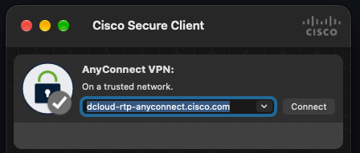
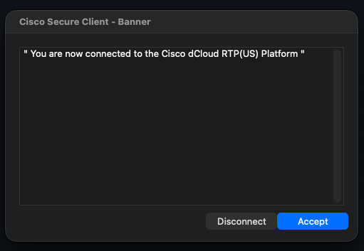

# Lab Access Guide

Complete these steps **before anything else**. Part 1 connects you to the Cisco dCloud network, which is required to reach the lab devices. Part 2 sets up SecureCRT and logs you in to them.

> **Cisco Secure Client is already installed on your PC.** You do not need to download or install anything for the VPN.

---

## What You Need Before Starting

You should have received a **lab credential sheet** with the following information. Confirm you have all values before proceeding:

| Item | Value |
|------|-------|
| **VPN Address** | e.g. `dcloud-sjc-anyconnect.cisco.com` |
| **VPN Username** | _(on your credential sheet)_ |
| **VPN Password** | _(on your credential sheet)_ |
| **Lab access method** | SecureCRT (Part 2) |
| **Device addresses** | `198.18.1.11` to `198.18.1.16` (routers), `198.18.1.21` to `198.18.1.26` (hosts), listed in Part 2 |
| **Device login** | Username `cisco`, password `cisco` (the same on every device) |

> **Do not have your credentials?** Raise your hand and a proctor will bring them to you before you proceed.

---

## Part 1 — Connect to the VPN

### Step 1 — Launch Cisco Secure Client

Find and open the **Cisco Secure Client** application on your laptop.


---

### Step 2 — Enter the VPN URL and Connect

The Cisco Secure Client window opens. In the address bar, enter the VPN URL from your credential sheet and click **Connect**.



> **Your VPN address is pod-specific** — use the address on your credential sheet, not the one shown in the screenshot.

---

### Step 3 — Enter Your Credentials

A login dialog will appear. Enter your pod username and password from your credential sheet, then click **OK**.


> **Credentials are case-sensitive.** Type them exactly as printed on your credential sheet.

---

### Step 4 — Accept the Connected Dialog

A confirmation dialog appears saying you are connected to the Cisco dCloud platform. Click **Accept**.



You are now on the dCloud network and can reach your lab devices.

---

## Part 2 — Connect to the Lab Devices with SecureCRT

You will use **SecureCRT** to log in to the lab devices over SSH. The lab has 12 devices:

| Folder in SecureCRT | Devices | Addresses |
|---|---|---|
| `Routers` | R1, R2, R3, R4, R5, R6 (Cisco IOS XR) | `198.18.1.11` to `198.18.1.16` |
| `Hosts` | alpine-1 to alpine-6 (Linux test hosts) | `198.18.1.21` to `198.18.1.26` |

The address ends in the device number: R3 is `198.18.1.13`, alpine-3 is `198.18.1.23`. Every device uses the username `cisco` and the password `cisco`.

> **You must be connected to the VPN (Part 1) before the devices will answer.** If SecureCRT says the connection timed out, check the VPN first.

---

### Step 1 — Create the sessions with the script

Instead of typing 12 sessions by hand, run the script your instructor provides, `Create-Sessions.py`. (It is also in the lab repository, in the `securecrt` folder.)

1. Open **SecureCRT**.
2. From the menu choose **Script > Run...**
3. Browse to `Create-Sessions.py`, select it and click **Run**.
4. A message box reports how many sessions were created. It should say **Created 12 of 12 sessions**.

> **The script does not save the password.** You type `cisco` each time you connect. It is safe to run the script again: it overwrites the sessions with the same names.

> **Script did not run?** Tell a proctor which message you got. As a fallback, create each session by hand: **File > Quick Connect...**, protocol **SSH2**, the hostname from the table above, username `cisco`.

---

### Step 2 — Connect to R1

1. Choose **File > Connect...** (Ctrl+Shift+C). The Connect window opens.
2. Open the **Austin Workshop** folder, then **Routers**, select **R1** and click **Connect**.
3. The first time you connect to a device, SecureCRT shows a **New Host Key** window. Click **Accept & Save**.
4. Enter the password `cisco` when asked. You can tick **Save password** if you do not want to retype it.

You are logged in when you see the router prompt:

```
RP/0/RP0/CPU0:R1#
```

> **First attempt failed or dropped?** The routers sometimes reset the very first SSH connection while they are busy. Connect again. If it keeps failing, wait a minute and try again.

---

### Step 3 — Check that you are on the right device

Run this on the router:

```
show ip interface brief
```

You will see the router's interfaces. The management interface `MgmtEth0/RP0/CPU0/0` should show the address you connected to (for R1, `198.18.1.11`).

The prompt shows the router name, so you can always tell which router a window is. When you have several windows open, look at the prompt before you type.

---

### Step 4 — Connect to a host

The hosts are ordinary Linux machines. Connect to **alpine-1** the same way: **File > Connect...**, **Austin Workshop > Hosts > alpine-1**, password `cisco`.

Check where you are:

```
hostname
```

```
alpine-1
```

---

### Working with several devices

Most tasks use more than one device at the same time, for example R1 and alpine-1, or four routers. A tidy way to work:

- Open each device in its **own tab** (SecureCRT opens new connections in tabs by default).
- Keep the tab names (R1, R4, alpine-1, ...) visible and check the prompt before you type a command.
- You can open the Connect window again at any time to add another device.

| Task | Devices you will use |
|---|---|
| Task 1 and Task 2 | R1 |
| Task 3 | R1, R4, alpine-1, alpine-4 |
| Task 4 | R2, R3, R5, R6, alpine-2, alpine-3, alpine-5, alpine-6 |

---

### Troubleshooting

| Symptom | Likely cause | What to do |
|---|---|---|
| Connection timed out | VPN not connected, or dropped | Check Cisco Secure Client shows **Connected**, and reconnect (Part 1) |
| Connection reset or closed straight after you connect | The device was busy | Connect again; wait a minute if it repeats |
| Password rejected | Typo | The password is `cisco`, all lowercase. Try again |
| Prompt shows a different router than you expected | Wrong tab | Check the tab name and the prompt before you type |
| A device that was just started does not answer | It is still booting (the hosts can take a few minutes longer than the routers) | Wait and retry; ask a proctor if it stays down |

---

**Next:** start with [Task 1 - IOS XR Basics](TASK1.md).
