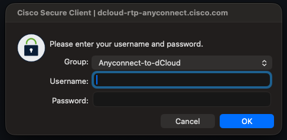

# Lab Access Guide

Complete these steps **before anything else**. By the end of Part 1 you will be connected to the Cisco dCloud network, which is required to reach the lab devices.

> **Cisco Secure Client is already installed on your PC.** You do not need to download or install anything for the VPN.

---

## What You Need Before Starting

You should have received a **lab credential sheet** with the following information. Confirm you have all values before proceeding:

| Item | Value |
|------|-------|
| **VPN Address** | e.g. `dcloud-sjc-anyconnect.cisco.com` |
| **VPN Username** | _(on your credential sheet)_ |
| **VPN Password** | _(on your credential sheet)_ |
| **Lab access method / address** | _TBD — added in Part 2_ |
| **Device login** | _TBD — added in Part 2_ |

> **Do not have your credentials?** Raise your hand and a proctor will bring them to you before you proceed.

---

## Part 1 — Connect to the VPN

### Step 1 — Launch Cisco Secure Client

Find and open the **Cisco Secure Client** application on your laptop.

---

### Step 2 — Enter the VPN URL and Connect

The Cisco Secure Client window opens. In the address bar, enter the VPN URL from your credential sheet and click **Connect**.

> **Your VPN address is pod-specific** — use the address on your credential sheet, not the one shown in the screenshot.

---

### Step 3 — Enter Your Credentials

A login dialog will appear. Enter your pod username and password from your credential sheet, then click **OK**.

> **Credentials are case-sensitive.** Type them exactly as printed on your credential sheet.

---

### Step 4 — Accept the Connected Dialog

A confirmation dialog appears saying you are connected to the Cisco dCloud platform. Click **Accept**.

You are now on the dCloud network and can reach your lab devices.

---

<!-- Part 2 (device access via SecureCRT/PuTTY or similar) to be added once the access method is decided -->
