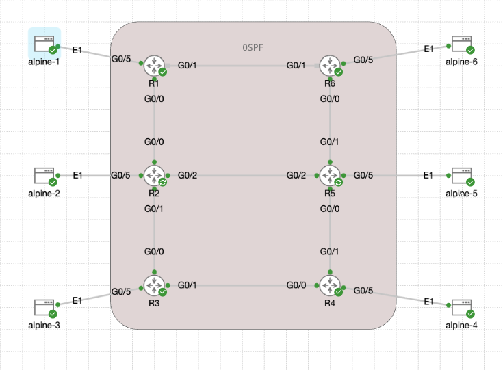

# Task 1 - Build the Underlay on R1

**Goal:** configure **R1** so it joins the existing network: IP addressing, OSPF, and Segment Routing (SR-MPLS).
Routers **R2-R6 are already configured**. Do not change them. When you finish, R1 will see every
other router and be able to reach it across the SR-MPLS core.

**What you will learn**
- The IOS XR configuration workflow (`configure`, `show configuration`, `commit`)
- Configuring a loopback and point-to-point /31 links
- Enabling OSPF and Segment Routing on an XR router
- Verifying neighbors, routes, MPLS labels and end-to-end reachability
- Testing the SR-MPLS label path itself with MPLS OAM (`ping sr-mpls`, `traceroute sr-mpls`)

**Time:** about 30 minutes.

---

## Your Network



R1 has two core links. These are the only interfaces you configure in this task.

| R1 interface | Connects to | R1 IP address | Neighbor IP address | Subnet |
|---|---|---|---|---|
| Loopback0 | (router ID) | `1.1.1.1/32` | | |
| GigabitEthernet0/0/0/0 | R2 Gi0/0/0/0 | `10.1.2.0/31` | `10.1.2.1` | `10.1.2.0/31` |
| GigabitEthernet0/0/0/1 | R6 Gi0/0/0/1 | `10.1.6.0/31` | `10.1.6.1` | `10.1.6.0/31` |

R1's Gi0/0/0/5 faces a host (alpine-1) and is **not** used until Task 2. Leave it shut down.

**Addressing rules used in this lab**
- Links use `10.<lower router>.<higher router>.<n>/31`. The lower-numbered router gets the even address.
- Each router's loopback is `R.R.R.R/32` (R1 = `1.1.1.1`).
- OSPF process `1`, area `0`. SR prefix-SID **index = router number**, so the label is `16000 + router number` (R1 = `16001`).
- Management addresses are `198.18.1.1X` (R1 = `198.18.1.11`) and are not part of this task.

**Starting state.** R1's two core interfaces are already enabled (`no shutdown`) and LLDP is on, so you can
see your neighbors, but the interfaces have no IP address yet.

---

## Step 0 - Log in and look around

Log in to R1 (`198.18.1.11`, username `cisco`, password `cisco`) and check where you are starting from.

```
show ip interface brief
```

```
RP/0/RP0/CPU0:R1#show ip interface brief
Interface                      IP-Address      Status          Protocol Vrf-Name
MgmtEth0/RP0/CPU0/0            198.18.1.11     Up              Up       management
GigabitEthernet0/0/0/0         unassigned      Up              Up       default
GigabitEthernet0/0/0/1         unassigned      Up              Up       default
GigabitEthernet0/0/0/2         unassigned      Shutdown        Down     default
GigabitEthernet0/0/0/3         unassigned      Shutdown        Down     default
GigabitEthernet0/0/0/4         unassigned      Shutdown        Down     default
GigabitEthernet0/0/0/5         unassigned      Shutdown        Down     default
```

```
show lldp neighbors
```

```
Device ID       Local Intf                      Hold-time  Capability      Port ID
R2              GigabitEthernet0/0/0/0          120        R               GigabitEthernet0/0/0/0
R6              GigabitEthernet0/0/0/1          120        R               GigabitEthernet0/0/0/1
```

LLDP confirms the cabling: R1 Gi0/0/0/0 reaches R2 and R1 Gi0/0/0/1 reaches R6.

### How configuration works on IOS XR

IOS XR does not apply changes the moment you type them. The workflow is:

| Command | What it does |
|---|---|
| `configure terminal` | Enter configuration mode. Your changes go into a *candidate* configuration. |
| `show configuration` | Show exactly what you are about to apply. Check it before you commit. |
| `commit` | Apply the candidate configuration to the running configuration. |
| `abort` | Throw the candidate configuration away and leave config mode. |
| `end` | Leave config mode (XR asks to commit if you have uncommitted changes). |

> **Remember to `commit`.** The most common mistake on XR is typing the commands and forgetting `commit`.
> If nothing seems to work, run `show configuration` in config mode. Anything listed there has not been applied yet.

---

## Step 1 - Loopback and link IP addresses

Configure the loopback, then the two core interfaces. Add a `description` to each: it makes the
router much easier to read and troubleshoot.

```
configure terminal
interface Loopback0
 description Router-ID and SR prefix-SID
 ipv4 address 1.1.1.1 255.255.255.255
 exit
interface GigabitEthernet0/0/0/0
 description to R2 Gi0/0/0/0
 ipv4 address 10.1.2.0 255.255.255.254
 exit
interface GigabitEthernet0/0/0/1
 description to R6 Gi0/0/0/1
 ipv4 address 10.1.6.0 255.255.255.254
 exit
show configuration
```

Check that the output matches what you intended:

```
interface Loopback0
 description Router-ID and SR prefix-SID
 ipv4 address 1.1.1.1 255.255.255.255
!
interface GigabitEthernet0/0/0/0
 description to R2 Gi0/0/0/0
 ipv4 address 10.1.2.0 255.255.255.254
!
interface GigabitEthernet0/0/0/1
 description to R6 Gi0/0/0/1
 ipv4 address 10.1.6.0 255.255.255.254
!
end
```

Apply it:

```
commit
end
```

> A `/31` has the subnet mask `255.255.255.254`. It uses both addresses of the pair, so there is no
> network or broadcast address on a point-to-point link.

### Verify Step 1

```
show ip interface brief
```

```
Interface                      IP-Address      Status          Protocol Vrf-Name
Loopback0                      1.1.1.1         Up              Up       default
MgmtEth0/RP0/CPU0/0            198.18.1.11     Up              Up       management
GigabitEthernet0/0/0/0         10.1.2.0        Up              Up       default
GigabitEthernet0/0/0/1         10.1.6.0        Up              Up       default
GigabitEthernet0/0/0/2         unassigned      Shutdown        Down     default
GigabitEthernet0/0/0/3         unassigned      Shutdown        Down     default
GigabitEthernet0/0/0/4         unassigned      Shutdown        Down     default
GigabitEthernet0/0/0/5         unassigned      Shutdown        Down     default
```

Ping each directly connected neighbor. R2 and R6 already have their side of the link configured.

```
ping 10.1.2.1
ping 10.1.6.1
```

```
RP/0/RP0/CPU0:R1#ping 10.1.2.1
Type escape sequence to abort.
Sending 5, 100-byte ICMP Echos to 10.1.2.1 timeout is 2 seconds:
!!!!!
Success rate is 100 percent (5/5), round-trip min/avg/max = 5/10/30 ms
RP/0/RP0/CPU0:R1#ping 10.1.6.1
Type escape sequence to abort.
Sending 5, 100-byte ICMP Echos to 10.1.6.1 timeout is 2 seconds:
!!!!!
Success rate is 100 percent (5/5), round-trip min/avg/max = 4/13/40 ms
```

**Checkpoint:** all three interfaces are `Up / Up` with the right addresses, and both pings show `!!!!!`.
Do not continue until they do.

---

## Step 2 - OSPF

Now exchange routes with R2 and R6. All routers use **OSPF process 1, area 0**.

```
configure terminal
router ospf 1
 router-id 1.1.1.1
 area 0
  interface Loopback0
   passive enable
   exit
  interface GigabitEthernet0/0/0/0
   network point-to-point
   exit
  interface GigabitEthernet0/0/0/1
   network point-to-point
   exit
  exit
 exit
show configuration
commit
end
```

Why these settings:
- **`router-id 1.1.1.1`**: a fixed, predictable router ID that matches the loopback.
- **`passive enable`** on the loopback: advertise the loopback into OSPF but do not send hellos out of it.
- **`network point-to-point`** on the links: no DR/BDR election is needed on a two-router link, so adjacencies come up faster and the configuration matches the neighbors.

### Verify Step 2

OSPF needs a few seconds to form adjacencies. If `show ospf neighbor` is empty right after the commit, wait about 15 seconds and run it again.

```
show ospf neighbor
```

```
Neighbors for OSPF 1

Neighbor ID     Pri   State           Dead Time   Address         Interface
2.2.2.2         1     FULL/  -        00:00:38    10.1.2.1        GigabitEthernet0/0/0/0
    Neighbor is up for 00:00:11
6.6.6.6         1     FULL/  -        00:00:35    10.1.6.1        GigabitEthernet0/0/0/1
    Neighbor is up for 00:00:14

Total neighbor count: 2
```

```
show route ospf
```

```
O    2.2.2.2/32 [110/2] via 10.1.2.1, 00:00:11, GigabitEthernet0/0/0/0
O    3.3.3.3/32 [110/3] via 10.1.2.1, 00:00:11, GigabitEthernet0/0/0/0
O    4.4.4.4/32 [110/4] via 10.1.2.1, 00:00:11, GigabitEthernet0/0/0/0
                [110/4] via 10.1.6.1, 00:00:11, GigabitEthernet0/0/0/1
O    5.5.5.5/32 [110/3] via 10.1.2.1, 00:00:11, GigabitEthernet0/0/0/0
                [110/3] via 10.1.6.1, 00:00:11, GigabitEthernet0/0/0/1
O    6.6.6.6/32 [110/2] via 10.1.6.1, 00:00:13, GigabitEthernet0/0/0/1
O    10.2.3.0/31 [110/2] via 10.1.2.1, 00:00:11, GigabitEthernet0/0/0/0
O    10.2.5.0/31 [110/2] via 10.1.2.1, 00:00:11, GigabitEthernet0/0/0/0
O    10.3.4.0/31 [110/3] via 10.1.2.1, 00:00:11, GigabitEthernet0/0/0/0
O    10.4.5.0/31 [110/3] via 10.1.2.1, 00:00:11, GigabitEthernet0/0/0/0
                 [110/3] via 10.1.6.1, 00:00:11, GigabitEthernet0/0/0/1
O    10.5.6.0/31 [110/2] via 10.1.6.1, 00:00:13, GigabitEthernet0/0/0/1
```

Notice that R4 (`4.4.4.4`) and R5 (`5.5.5.5`) each have **two** equal-cost paths, one through R2 and one through R6.
This is ECMP (equal-cost multipath).

Test reachability to routers further away. Use `source 1.1.1.1` so the ping is sent from your loopback.
That tests loopback-to-loopback reachability, which is what the rest of the lab depends on.
(Without `source`, XR uses the address of the exit interface.)

```
ping 6.6.6.6 source 1.1.1.1
ping 4.4.4.4 source 1.1.1.1
```

```
RP/0/RP0/CPU0:R1#ping 6.6.6.6 source 1.1.1.1
Type escape sequence to abort.
Sending 5, 100-byte ICMP Echos to 6.6.6.6 timeout is 2 seconds:
!!!!!
Success rate is 100 percent (5/5), round-trip min/avg/max = 3/6/15 ms
RP/0/RP0/CPU0:R1#ping 4.4.4.4 source 1.1.1.1
Type escape sequence to abort.
Sending 5, 100-byte ICMP Echos to 4.4.4.4 timeout is 2 seconds:
!!!!!
Success rate is 100 percent (5/5), round-trip min/avg/max = 6/7/10 ms
```

**Checkpoint:** two neighbors in state `FULL`, five loopback routes (`2.2.2.2` to `6.6.6.6`) in the routing table, and both pings succeed.

---

## Step 3 - Segment Routing (SR-MPLS)

Right now the network routes with plain IP. Segment Routing gives every router a **prefix-SID**, a label that
identifies it, and OSPF distributes those labels. No LDP or RSVP is needed. All routers use the default
SR label range (SRGB) **16000-23999**, and each router's label is `16000 + index`.

```
configure terminal
router ospf 1
 segment-routing mpls
 area 0
  interface Loopback0
   prefix-sid index 1
   exit
  exit
 exit
show configuration
commit
end
```

You should see:

```
router ospf 1
 segment-routing mpls
 area 0
  interface Loopback0
   prefix-sid index 1
  !
 !
!
end
```

- **`segment-routing mpls`** turns on SR-MPLS in OSPF.
- **`prefix-sid index 1`** gives R1's loopback the label `16000 + 1 = 16001`. Every other router has already advertised its own: R2 = 16002, R3 = 16003, R4 = 16004, R5 = 16005, R6 = 16006.

### Verify Step 3

Look at the MPLS forwarding table. Each remote router should have a label:

```
show mpls forwarding
```

```
Local  Outgoing    Prefix             Outgoing     Next Hop        Bytes
Label  Label       or ID              Interface                    Switched
------ ----------- ------------------ ------------ --------------- ------------
16002  Pop         SR Pfx (idx 2)     Gi0/0/0/0    10.1.2.1        0
16003  16003       SR Pfx (idx 3)     Gi0/0/0/0    10.1.2.1        0
16004  16004       SR Pfx (idx 4)     Gi0/0/0/0    10.1.2.1        0
       16004       SR Pfx (idx 4)     Gi0/0/0/1    10.1.6.1        0
16005  16005       SR Pfx (idx 5)     Gi0/0/0/0    10.1.2.1        0
       16005       SR Pfx (idx 5)     Gi0/0/0/1    10.1.6.1        0
16006  Pop         SR Pfx (idx 6)     Gi0/0/0/1    10.1.6.1        0
24000  Pop         SR Adj (idx 0)     Gi0/0/0/0    10.1.2.1        0
24001  Pop         SR Adj (idx 0)     Gi0/0/0/1    10.1.6.1        0
```

How to read it:
- **`SR Pfx (idx N)`** is the prefix-SID of router N. Label `16000 + N`.
- **`Pop`** means the next hop is the destination router itself, so the label is removed (penultimate hop popping). That is why R2 and R6, R1's direct neighbors, show `Pop`.
- A label going out as itself (for example `16004` to `16004`) is a **swap**: the transit router keeps the same label, because every router uses the same SRGB.
- **`SR Adj`** entries (24000+) are adjacency-SIDs: labels for the individual links.

See how the route for R4 carries its label:

```
show route 4.4.4.4/32 detail
```

```
Routing entry for 4.4.4.4/32
  Known via "ospf 1", distance 110, metric 4, labeled SR, type intra area
  Routing Descriptor Blocks
    10.1.2.1, from 4.4.4.4, via GigabitEthernet0/0/0/0
      Route metric is 4
      Label: 0x3e84 (16004)
    10.1.6.1, from 4.4.4.4, via GigabitEthernet0/0/0/1
      Route metric is 4
      Label: 0x3e84 (16004)
  Local Label: 0x3e84 (16004)
```

`labeled SR` and `Label: 16004` show that the route is carried with its SR label, on both ECMP paths.

Now trace the path to R4 and watch the label appear on the first hop:

```
traceroute 4.4.4.4 source 1.1.1.1
```

```
Tracing the route to 4.4.4.4
 1  10.1.6.1 [MPLS: Label 16004 Exp 0] 11 msec  8 msec
    10.1.2.1 14 msec
 2  10.2.3.1 [MPLS: Label 16004 Exp 0] 17 msec
    10.2.5.1 13 msec  7 msec
 3  10.4.5.0 12 msec  *  12 msec
```

The traffic is **label-switched**: `[MPLS: Label 16004]` is R4's prefix-SID. Because R4 has two equal paths from R1, the probes are spread across both. Routers show up in different orders from run to run, so your output may differ slightly. The label is what matters.

Finally, check that the other routers can see you. On **R4**, look up R1's loopback:

```
show mpls forwarding prefix 1.1.1.1/32
```

```
Local  Outgoing    Prefix             Outgoing     Next Hop        Bytes
Label  Label       or ID              Interface                    Switched
------ ----------- ------------------ ------------ --------------- ------------
16001  16001       SR Pfx (idx 1)     Gi0/0/0/0    10.3.4.0        336
       16001       SR Pfx (idx 1)     Gi0/0/0/1    10.4.5.1        864
```

R4 now has R1's label (`16001`), so R1 is fully part of the SR domain.

---

## Step 4 - MPLS OAM: ping and traceroute the label path

The `ping` and `traceroute` you have used so far test IP reachability. **MPLS OAM** lets you test the
**SR label-switched path (LSP)** itself: the router sends an MPLS echo request along the same labels that
real traffic would use, which proves the labels are programmed correctly on every hop. You will use this
again in Task 2 to check the transport underneath the pseudowires.

Try it first:

```
ping sr-mpls 6.6.6.6/32
```

```
RP/0/RP0/CPU0:R1#ping sr-mpls 6.6.6.6/32
% MPLS Embedded Management Subsystem is not running.
To enable, use 'mpls oam' global config command.
```

The error tells you what to do. R2-R6 already have `mpls oam`, so R1 is the last router that needs it:

```
configure terminal
mpls oam
 exit
show configuration
commit
end
```

```
mpls oam
!
end
```

### Verify Step 4

Ping the SR path to each router (the long legend of result codes is left out below):

```
ping sr-mpls 6.6.6.6/32
ping sr-mpls 2.2.2.2/32
ping sr-mpls 3.3.3.3/32
ping sr-mpls 4.4.4.4/32
ping sr-mpls 5.5.5.5/32
```

```
RP/0/RP0/CPU0:R1#ping sr-mpls 6.6.6.6/32
Sending 5, 100-byte MPLS Echos to 6.6.6.6/32,
      timeout is 2 seconds, send interval is 0 msec:
...
Type escape sequence to abort.
!!!!!
Success rate is 100 percent (5/5), round-trip min/avg/max = 6/7/11 ms
```

Every ping should show `!!!!!` (100 percent). Now trace the label path to R4:

```
traceroute sr-mpls 4.4.4.4/32
```

```
Tracing MPLS Label Switched Path to 4.4.4.4/32, timeout is 2 seconds
...
Type escape sequence to abort.
  0 10.1.6.0 MRU 1500 [Labels: 16004 Exp: 0]
L 1 10.1.6.1 MRU 1500 [Labels: 16004 Exp: 0] 14 ms
L 2 10.5.6.0 MRU 1500 [Labels: implicit-null Exp: 0] 14 ms
! 3 10.4.5.0 14 ms
```

How to read it:
- **Hop 0** is R1 itself, sending the packet with label `16004` (R4's prefix-SID).
- **`L` hops** are routers that forwarded the packet using its label. Hop 1 is R6, hop 2 is R5.
- **`implicit-null`** at hop 2 means R5 is the last hop before R4, so it pops the label (the same *Pop* you saw in `show mpls forwarding`).
- **`!`** means the packet reached the destination, R4 (`10.4.5.0`).

R4 has two equal-cost paths from R1, so your trace may go through R2 and R3 or R2 and R5 instead of R6 and R5. Either is correct.

**Checkpoint:** all five `ping sr-mpls` commands succeed, and the traceroute ends with a `!` at R4.

---

## Final Verification

Run every check from R1. All of them must pass.

| # | Check | Command | Expected |
|---|---|---|---|
| 1 | Interfaces up with IPs | `show ip interface brief` | Loopback0, Gi0/0/0/0, Gi0/0/0/1 are `Up / Up` with the right addresses |
| 2 | Direct neighbors | `ping 10.1.2.1` and `ping 10.1.6.1` | `!!!!!` (100 percent) |
| 3 | OSPF adjacencies | `show ospf neighbor` | `2.2.2.2` and `6.6.6.6` in state `FULL`, 2 neighbors |
| 4 | Routes | `show route ospf` | Loopbacks `2.2.2.2` to `6.6.6.6` present |
| 5 | SR labels | `show mpls forwarding` | Labels 16002 to 16006 present |
| 6 | All loopbacks reachable | `ping <loopback> source 1.1.1.1` for each of 2.2.2.2 to 6.6.6.6 | 100 percent each |
| 7 | Label switching | `traceroute 4.4.4.4 source 1.1.1.1` | `[MPLS: Label 16004]` on hop 1 |
| 8 | SR label path | `ping sr-mpls <loopback>/32` for each of 2.2.2.2 to 6.6.6.6 | `!!!!!` (100 percent) each |
| 9 | SR label trace | `traceroute sr-mpls 4.4.4.4/32` | Ends with `!` at R4 (`10.4.5.0` or `10.3.4.1`, depending on the path) |

A quick way to run check 6:

```
ping 2.2.2.2 source 1.1.1.1
ping 3.3.3.3 source 1.1.1.1
ping 4.4.4.4 source 1.1.1.1
ping 5.5.5.5 source 1.1.1.1
ping 6.6.6.6 source 1.1.1.1
```

Your changes are in effect as soon as you `commit`. Review what you configured with
`show running-config` and compare it to the answer at the end of this guide.

---

## Troubleshooting

| Symptom | Likely cause | What to check |
|---|---|---|
| Nothing seems to have changed | You did not `commit` | In config mode, `show configuration` lists uncommitted changes |
| Cannot ping the neighbor | Wrong IP or mask | `show ip interface brief`. A `/31` mask is `255.255.255.254`. Your address must be the `.0` of the pair; the neighbor is `.1` |
| Interface is `Shutdown` | Not enabled | Core interfaces should already be up. If not, `interface <name>` then `no shutdown` and `commit` |
| No OSPF neighbor | Interface missing under OSPF, or wrong area | `show ospf interface brief` should list `Lo0`, `Gi0/0/0/0`, `Gi0/0/0/1` all in area 0 |
| OSPF stuck in `EXSTART` or `INIT` | Mismatched `network` type, MTU or addressing | `show ospf interface Gi0/0/0/0`. The type should be point-to-point |
| Routes but no labels | `segment-routing mpls` missing, or no prefix-SID | `show running-config router ospf 1` |
| `MPLS Embedded Management Subsystem is not running` | `mpls oam` not configured | Add `mpls oam` in config mode and `commit` |
| `ping sr-mpls` shows `.` or `F` instead of `!` | Prefix-SID or label missing on a router in the path | `show mpls forwarding` should list a label for that loopback; check `prefix-sid index` |
| Wrong label for R1 | Wrong index | `prefix-sid index 1`, so R1 = 16001. Not `16001` as the index itself |
| Ping to a loopback fails | Loopback not advertised, or OSPF not converged yet | `show route ospf` should list that loopback. Wait 15 seconds after the commit, then retry |

Handy commands:

```
show running-config interface GigabitEthernet0/0/0/0
show running-config router ospf 1
show configuration commit changes last 1
show ospf interface brief
show ospf neighbor detail
```

To undo your last commit if you made a mistake:

```
rollback configuration last 1
```

---

## Compare with the answer

<details>
<summary>Click to see the finished R1 configuration</summary>

```
interface Loopback0
 description Router-ID and SR prefix-SID
 ipv4 address 1.1.1.1 255.255.255.255
!
interface GigabitEthernet0/0/0/0
 description to R2 Gi0/0/0/0
 ipv4 address 10.1.2.0 255.255.255.254
!
interface GigabitEthernet0/0/0/1
 description to R6 Gi0/0/0/1
 ipv4 address 10.1.6.0 255.255.255.254
!
router ospf 1
 router-id 1.1.1.1
 segment-routing mpls
 area 0
  interface Loopback0
   passive enable
   prefix-sid index 1
  !
  interface GigabitEthernet0/0/0/0
   network point-to-point
  !
  interface GigabitEthernet0/0/0/1
   network point-to-point
  !
 !
!
mpls oam
!
```

</details>

---

## Optional: see what the other routers look like

Because R2-R6 were pre-built from the same pattern, you can compare your configuration with a neighbor's.
Log in to R2 (`198.18.1.12`) and run `show running-config router ospf 1`. Do not change it.

**Next:** Task 2 - Pseudowires.
