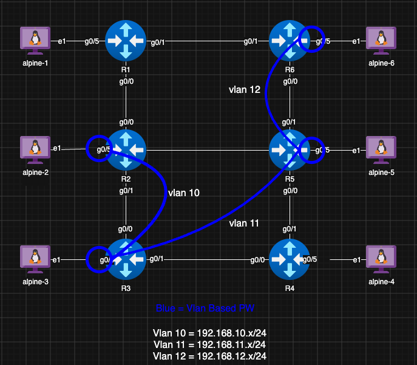

# Task 4 - Build VLAN-Based Pseudowires (R2, R3, R5, R6)

> **Prerequisite:** complete [Task 3 - Port-Based Pseudowire](TASK3.md) first. This task assumes you know what an attachment
> circuit, a pseudowire and targeted LDP are. Task 4 does not need R1 or R4.

**Goal:** build **three VLAN-based pseudowires** that chain four hosts together:

```
alpine-2 --VLAN 10-- alpine-3 --VLAN 11-- alpine-5 --VLAN 12-- alpine-6
```

In Task 3 a whole port went into one pseudowire. Here a **single port carries several VLANs**, and each VLAN
goes into its **own** pseudowire. At the end, alpine-2 reaches alpine-6 across all three.

**What you will learn**
- The difference between a port-based and a VLAN-based attachment circuit
- Configuring an `l2transport` sub-interface that matches one VLAN (`encapsulation dot1q`)
- Putting two pseudowires on one physical port (R3 and R5 do this)
- Reading a VLAN-based PW in `show l2vpn xconnect detail`
- Why a wrong VLAN number leaves the PW **up** while no traffic passes

**Time:** about 45 minutes (an estimate, not yet timed with a student).

---

## Port-based vs VLAN-based

| | Port-based (Task 3) | VLAN-based (this task) |
|---|---|---|
| Attachment circuit | The whole port, `Gi0/0/0/5` | A **sub-interface**, `Gi0/0/0/5.10` |
| What goes into the PW | Every frame on the port | Only frames tagged with the VLAN you match |
| PWs per port | One | Many, one per VLAN |
| Key command | `l2transport` on the port | `interface Gi0/0/0/5.10 l2transport` and `encapsulation dot1q 10` |

The hosts send **tagged** frames. Each alpine host already has a VLAN interface on its `eth1` (for example `eth1.10`)
with an address in that VLAN's subnet. The router looks at the VLAN tag and picks the PW.

---

## Your Network



| PW | VLAN | Subnet | Routers (PW ends) | Hosts | PW ID |
|---|---|---|---|---|---|
| PW2 | 10 | `192.168.10.0/24` | R2 - R3 | alpine-2 `.2`, alpine-3 `.3` | `10` |
| PW3 | 11 | `192.168.11.0/24` | R3 - R5 | alpine-3 `.3`, alpine-5 `.5` | `11` |
| PW4 | 12 | `192.168.12.0/24` | R5 - R6 | alpine-5 `.5`, alpine-6 `.6` | `12` |

| Router | Loopback0 | AC port | Sub-interface(s) to create | PW peer(s) |
|---|---|---|---|---|
| R2 | `2.2.2.2` | Gi0/0/0/5 | `.10` | R3 `3.3.3.3` (pw-id 10) |
| R3 | `3.3.3.3` | Gi0/0/0/5 | `.10` and `.11` | R2 `2.2.2.2` (pw-id 10), R5 `5.5.5.5` (pw-id 11) |
| R5 | `5.5.5.5` | Gi0/0/0/5 | `.11` and `.12` | R3 `3.3.3.3` (pw-id 11), R6 `6.6.6.6` (pw-id 12) |
| R6 | `6.6.6.6` | Gi0/0/0/5 | `.12` | R5 `5.5.5.5` (pw-id 12) |

Naming used in this task: xconnect group `VLAN_BASED` on every router, and the point-to-point name is `VLAN<n>`
(`VLAN10`, `VLAN11`, `VLAN12`). Names only matter locally; the **pw-id and the peer address must match** on both ends.
We use the VLAN number as the pw-id to make it easy to remember. It is a choice, not a rule.

**The hosts do the routing, not the routers.** A pseudowire is plain Layer 2. alpine-2 and alpine-6 are not in the same
subnet, so their traffic is **routed** by alpine-3 (between VLAN 10 and 11) and alpine-5 (between VLAN 11 and 12). Those
two hosts already have IP forwarding on, and every host already has the static routes it needs. You do not touch the
hosts.

**Starting state**
- R2-R6 are pre-built, with targeted LDP already configured. You do not need to add LDP anywhere.
- Gi0/0/0/5 is shut down on R2, R3, R5 and R6.
- Hosts are ready.

---

## Step 0 - Check where you are starting from

On **R2** (`198.18.1.12`, `cisco` / `cisco`):

```
show running-config mpls ldp
show ip interface brief GigabitEthernet0/0/0/5
```

```
mpls ldp
 router-id 2.2.2.2
 address-family ipv4
  discovery targeted-hello accept
 !
!

Interface                      IP-Address      Status                Protocol
GigabitEthernet0/0/0/5         unassigned      Shutdown              Down
```

LDP is there, and the port is shut. On **alpine-2** (`ssh cisco@198.18.1.22`) look at the host side and try to reach alpine-3:

```
ip -4 addr show eth1.10
ip route | grep 192.168
ping -c 3 -W 2 192.168.10.3
```

```
    inet 192.168.10.2/24 scope global eth1.10
192.168.10.0/24 dev eth1.10 scope link  src 192.168.10.2
192.168.11.0/24 via 192.168.10.3 dev eth1.10
192.168.12.0/24 via 192.168.10.3 dev eth1.10

3 packets transmitted, 0 packets received, 100% packet loss
```

The host is ready: it has `eth1.10`, and it sends everything for VLANs 11 and 12 through alpine-3. The only thing missing is the
network in between. Keep a window open on alpine-2.

---

## Step 1 - Build R2: one VLAN, one PW

R2 has one VLAN, so it is the simplest. There are three parts:

1. **Enable the parent port.** `Gi0/0/0/5` itself is **not** put in `l2transport` this time. It is just brought up.
2. **Create the sub-interface** `Gi0/0/0/5.10` as an `l2transport` interface and match VLAN 10 with `encapsulation dot1q 10`.
3. **Build the xconnect** with the sub-interface as the AC.

```
configure terminal
interface GigabitEthernet0/0/0/5
 description to alpine-2 eth1
 no shutdown
 exit
interface GigabitEthernet0/0/0/5.10 l2transport
 description VLAN 10
 encapsulation dot1q 10
 exit
l2vpn
 xconnect group VLAN_BASED
  p2p VLAN10
   interface GigabitEthernet0/0/0/5.10
   neighbor ipv4 3.3.3.3 pw-id 10
   exit
  exit
 exit
show configuration
```

```
RP/0/RP0/CPU0:R2(config-l2vpn)#show configuration
!! IOS XR Configuration 25.1.1
interface GigabitEthernet0/0/0/5
 description to alpine-2 eth1
 no shutdown
!
interface GigabitEthernet0/0/0/5.10 l2transport
 description VLAN 10
 encapsulation dot1q 10
!
l2vpn
 xconnect group VLAN_BASED
  p2p VLAN10
   interface GigabitEthernet0/0/0/5.10
   neighbor ipv4 3.3.3.3 pw-id 10
   !
  !
 !
!
end
```

> **Compare with Task 3.** There, `l2transport` sat *inside* `interface Gi0/0/0/5`. Here it is part of the sub-interface
> name, on the same line: `interface Gi0/0/0/5.10 l2transport`. The sub-interface number (`.10`) is only a label. It is
> `encapsulation dot1q 10` that decides which VLAN is matched. We use the same number for both so it is easy to read.

```
commit
end
```

Check the interfaces:

```
show ip interface brief
```

```
GigabitEthernet0/0/0/5         unassigned      Up              Up       default
GigabitEthernet0/0/0/5.10      unassigned      Up              Up       default
```

(Output trimmed to the two interesting lines.) The parent and the sub-interface are both up, and neither has an IP address. The sub-interface is a Layer 2 interface.

R3 is not built yet, so the PW will not come up:

```
show l2vpn xconnect
```

You will see `DN` for the cross-connect, as in Task 3.

---

## Step 2 - Build R3: two VLANs on one port

R3 is in the middle of the chain: VLAN 10 toward R2 and VLAN 11 toward R5. Both arrive on the **same port**, `Gi0/0/0/5`
(that port goes to alpine-3). Create **two sub-interfaces** and **two cross-connects**:

```
configure terminal
interface GigabitEthernet0/0/0/5
 description to alpine-3 eth1
 no shutdown
 exit
interface GigabitEthernet0/0/0/5.10 l2transport
 description VLAN 10
 encapsulation dot1q 10
 exit
interface GigabitEthernet0/0/0/5.11 l2transport
 description VLAN 11
 encapsulation dot1q 11
 exit
l2vpn
 xconnect group VLAN_BASED
  p2p VLAN10
   interface GigabitEthernet0/0/0/5.10
   neighbor ipv4 2.2.2.2 pw-id 10
   exit
  p2p VLAN11
   interface GigabitEthernet0/0/0/5.11
   neighbor ipv4 5.5.5.5 pw-id 11
   exit
  exit
 exit
show configuration
```

```
RP/0/RP0/CPU0:R3(config-l2vpn)#show configuration
!! IOS XR Configuration 25.1.1
interface GigabitEthernet0/0/0/5
 description to alpine-3 eth1
 no shutdown
!
interface GigabitEthernet0/0/0/5.10 l2transport
 description VLAN 10
 encapsulation dot1q 10
!
interface GigabitEthernet0/0/0/5.11 l2transport
 description VLAN 11
 encapsulation dot1q 11
!
l2vpn
 xconnect group VLAN_BASED
  p2p VLAN10
   interface GigabitEthernet0/0/0/5.10
   neighbor ipv4 2.2.2.2 pw-id 10
   !
  !
  p2p VLAN11
   interface GigabitEthernet0/0/0/5.11
   neighbor ipv4 5.5.5.5 pw-id 11
   !
  !
 !
!
end
```

This is the key idea of the task: one physical port, two pseudowires going to **different** routers. The router splits the traffic by VLAN tag.
That is not possible with a port-based PW.

```
commit
end
```

R2 and R3 now both have their ends of the VLAN 10 PW. Check it from R3:

```
show l2vpn xconnect
```

Wait about 30 seconds. The `VLAN10` row is now `UP` / `UP` / `UP`, because both of its ends exist:

```
VLAN_BASED VLAN10     UP   Gi0/0/0/5.10           UP       2.2.2.2         10     UP
```

The `VLAN11` row is still `DN`, because R5 is not configured yet.

---

## Step 3 - Build R5 and R6 yourself

You now know the pattern. Build **R5** and **R6** using the tables in "Your Network". For each router:

1. `no shutdown` on `Gi0/0/0/5`, with a `description`.
2. One `l2transport` sub-interface per VLAN, with `encapsulation dot1q <vlan>`.
3. `l2vpn` / `xconnect group VLAN_BASED` with one `p2p` per VLAN, using the sub-interface, the peer's loopback and the pw-id.

Reminders:
- **R5** has two VLANs (11 toward R3, 12 toward R6), like R3.
- **R6** has one VLAN (12 toward R5), like R2.
- Use `show configuration` before every `commit`, and compare it with what you intended.

If you get stuck, the finished configuration is at the end of this guide.

---

## Step 4 - Verify the pseudowires

On every router, `show l2vpn xconnect` must show every cross-connect `UP / UP / UP`. From **R3**, which has two:

```
show l2vpn xconnect
```

```
XConnect                   Segment 1                       Segment 2
Group      Name       ST   Description            ST       Description            ST
------------------------   -----------------------------   -----------------------------
VLAN_BASED VLAN10     UP   Gi0/0/0/5.10           UP       2.2.2.2         10     UP
VLAN_BASED VLAN11     UP   Gi0/0/0/5.11           UP       5.5.5.5         11     UP
```

Look at one in detail. On **R2**:

```
show l2vpn xconnect detail
```

```
Group VLAN_BASED, XC VLAN10, state is up; Interworking none
  AC: GigabitEthernet0/0/0/5.10, state is up
    Type VLAN; Num Ranges: 1
    Rewrite Tags: []
    VLAN ranges: [10, 10]
    MTU 1504; XC ID 0x2; interworking none
    Statistics:
      packets: received 31, sent 31
      bytes: received 2678, sent 2846
      drops: illegal VLAN 0, illegal length 0
  PW: neighbor 3.3.3.3, PW ID 10, state is up ( established )
    Encapsulation MPLS, protocol LDP
    Source address 2.2.2.2
    PW type Ethernet, control word disabled, interworking none
    LSP : Up
    Nexthop type: IPV4 3.3.3.3
    PW Status TLV in use
      MPLS         Local                          Remote
      ------------ ------------------------------ -----------------------------
      Label        24012                          24015
      Interface    GigabitEthernet0/0/0/5.10      GigabitEthernet0/0/0/5.10
      MTU          1504                           1504
```

(Output trimmed. Your numbers will differ.) Compare it with Task 3 and find what is new:

| Field | Meaning |
|---|---|
| `Type VLAN` and `VLAN ranges: [10, 10]` | This AC matches VLAN 10 only. In Task 3 it said `Type Ethernet` (the whole port) |
| `Rewrite Tags: []` | No tag is added or removed. The frame keeps its VLAN tag all the way through the PW, so the host on the far side receives the frame still tagged with VLAN 10 |
| `MTU 1504` | Task 3 showed 1500. The VLAN-based AC shows 4 bytes more, the size of a VLAN tag. Both ends show 1504, and they are expected to agree |
| `drops: illegal VLAN` | A drop counter for this AC. It was 0 in our tests |

The LDP sessions: R3 has two, one for each PW peer.

```
show mpls ldp neighbor brief
```

```
Peer               GR  NSR  Up Time     Discovery   Addresses     Labels
                                        ipv4  ipv6  ipv4  ipv6  ipv4   ipv6
-----------------  --  ---  ----------  ----------  ----------  ------------
2.2.2.2:0          N   N    00:02:48    1     0     4     0     12     0
5.5.5.5:0          N   N    00:02:37    1     0     4     0     12     0
```

And the PWs in the label table, each tied to its own sub-interface:

```
show mpls forwarding | include PW
```

```
24013  Pop         PW(5.5.5.5:11)     Gi0/0/0/5.11 point2point     3058
24015  Pop         PW(2.2.2.2:10)     Gi0/0/0/5.10 point2point     2678
```

Then test each PW with PW OAM, using the peer and the pw-id (from R3):

```
ping mpls pseudowire 2.2.2.2 10
ping mpls pseudowire 5.5.5.5 11
```

```
Sending 5, 100-byte MPLS Echos to 2.2.2.2 VC: 10,
      timeout is 2 seconds, send interval is 0 msec:
!!!!!
Success rate is 100 percent (5/5), round-trip min/avg/max = 8/8/9 ms
```

---

## Step 5 - Ping across the pseudowires

### One VLAN at a time

Each PW first. From **alpine-2** to alpine-3 over VLAN 10:

```
ping -c 3 192.168.10.3
ip neigh show dev eth1.10
```

```
3 packets transmitted, 3 packets received, 0% packet loss
192.168.10.3 lladdr 52:54:00:e2:34:74 ref 1 used 0/0/0 probes 4 REACHABLE
```

The `lladdr` entry (the MAC addresses in your lab will differ) shows that ARP crossed the PW, as in Task 3. Do the other two:

| From | Command | Over |
|---|---|---|
| alpine-3 | `ping -c 3 192.168.11.5` | VLAN 11 (PW3) |
| alpine-5 | `ping -c 3 192.168.12.6` | VLAN 12 (PW4) |

All three must show 0% packet loss.

### End to end

Now the real test. From **alpine-2**, ping **alpine-6**, which is three PWs away and in a different subnet:

```
ping -c 4 192.168.12.6
traceroute -n 192.168.12.6
```

```
PING 192.168.12.6 (192.168.12.6): 56 data bytes
64 bytes from 192.168.12.6: seq=0 ttl=42 time=11.837 ms
64 bytes from 192.168.12.6: seq=1 ttl=42 time=12.004 ms
64 bytes from 192.168.12.6: seq=2 ttl=42 time=12.147 ms
64 bytes from 192.168.12.6: seq=3 ttl=42 time=12.003 ms

--- 192.168.12.6 ping statistics ---
4 packets transmitted, 4 packets received, 0% packet loss

traceroute to 192.168.12.6 (192.168.12.6), 30 hops max, 46 byte packets
 1  192.168.10.3  2.622 ms  2.411 ms  2.222 ms
 2  192.168.11.5  5.655 ms  5.899 ms  5.768 ms
 3  192.168.12.6  9.157 ms  9.069 ms  8.414 ms
```

Read the traceroute, it explains the whole design. There are **three** IP hops, and **none of them is a router running XR**:

| Hop | Address | What it is |
|---|---|---|
| 1 | `192.168.10.3` | alpine-3, reached over VLAN 10 (PW2) |
| 2 | `192.168.11.5` | alpine-5, reached over VLAN 11 (PW3) |
| 3 | `192.168.12.6` | alpine-6, reached over VLAN 12 (PW4) |

The six XR routers and the MPLS core are invisible. To the hosts, each PW is just a cable. The packets are **routed** by
the two hosts in the middle, and **switched** by the pseudowires.

Try the other direction, from **alpine-6**:

```
ping -c 4 192.168.10.2
```

You should also be able to reach the middle hosts' other addresses from the ends. For example, from alpine-2 `ping 192.168.12.5`, and from alpine-6 `ping 192.168.11.3`.

### The port-based island stays separate

The pseudowire from Task 3 (alpine-1 and alpine-4, `172.16.1.0/24`) is a different Layer 2 segment, and none of these hosts has a route to it. From
alpine-2:

```
ping -c 2 -W 2 172.16.1.1
```

```
2 packets transmitted, 0 packets received, 100% packet loss
```

That is the expected result. A separate PW means a separate segment.

---

## Final Verification

| # | Check | Where | Command | Expected |
|---|---|---|---|---|
| 1 | Parent port up | R2, R3, R5, R6 | `show ip interface brief` | `Gi0/0/0/5` and each `.vlan` sub-interface `Up / Up` |
| 2 | Cross-connects | all four | `show l2vpn xconnect` | Every row `UP` / `UP` / `UP` (R2 and R6: 1 row, R3 and R5: 2 rows) |
| 3 | AC type | R2 | `show l2vpn xconnect detail` | `Type VLAN`, `VLAN ranges: [10, 10]`, `Rewrite Tags: []` |
| 4 | LDP sessions | R3, R5 | `show mpls ldp neighbor brief` | Two peers each |
| 5 | PWs in label table | R3 | `show mpls forwarding \| include PW` | `PW(2.2.2.2:10)` out `.10` and `PW(5.5.5.5:11)` out `.11` |
| 6 | PW OAM | R3 | `ping mpls pseudowire 2.2.2.2 10` and `... 5.5.5.5 11` | `!!!!!` each |
| 7 | VLAN 10 | alpine-2 | `ping -c 3 192.168.10.3` | 0% loss |
| 8 | VLAN 11 | alpine-3 | `ping -c 3 192.168.11.5` | 0% loss |
| 9 | VLAN 12 | alpine-5 | `ping -c 3 192.168.12.6` | 0% loss |
| 10 | End to end | alpine-2 | `ping -c 4 192.168.12.6` | 0% loss |
| 11 | Path | alpine-2 | `traceroute -n 192.168.12.6` | Hops `192.168.10.3`, `192.168.11.5`, `192.168.12.6` |
| 12 | Reverse | alpine-6 | `ping -c 4 192.168.10.2` | 0% loss |

(In check 5 the `\|` is a normal `|` pipe on the router. It is escaped only so the table renders.)

---

## Troubleshooting

| Symptom | Likely cause | What to check |
|---|---|---|
| Cross-connect `UP` / `UP` / `UP`, but the hosts cannot ping | **Wrong VLAN number** in `encapsulation dot1q` on one router | `show l2vpn xconnect detail`: look at `VLAN ranges`. It must match the VLAN the host uses (the number in the host's interface name, such as `eth1.10`). See below |
| Cross-connect `DN`, AC shows `state is down (Admin)` | The parent port `Gi0/0/0/5` is still shut down | `no shutdown` on `Gi0/0/0/5` (the parent, not the sub-interface) and `commit` |
| `DN` / `UP` / `DN`, targeted hello is present | Other end not built yet | Finish the other router |
| `state is down ( local ready )`, remote label `unknown` | pw-id mismatch, or wrong peer address | Compare `neighbor ipv4 ... pw-id ...` on both ends (as in Task 3) |
| One VLAN works, the other does not, on R3 or R5 | Mixed up sub-interfaces: for example `.10` attached to the VLAN 11 PW | `show running-config l2vpn` and check each `p2p` uses the right sub-interface and peer |
| Neighbors in the same VLAN reach each other, but alpine-2 cannot reach alpine-6 | Routing problem on a host, not a PW problem | `ip route` on the hosts, and `cat /proc/sys/net/ipv4/ip_forward` is `1` on alpine-3 and alpine-5. You should not change these |

### What a wrong VLAN looks like

This is the most instructive mistake, so here is what it does. On R6 we changed `encapsulation dot1q 12` to `encapsulation dot1q 99`
and committed:

```
show l2vpn xconnect
```

```
VLAN_BASED VLAN12     UP   Gi0/0/0/5.12           UP       5.5.5.5         12     UP
```

```
show l2vpn xconnect detail
```

```
  AC: GigabitEthernet0/0/0/5.12, state is up
    VLAN ranges: [99, 99]
  PW: neighbor 5.5.5.5, PW ID 12, state is up ( established )
```

Everything is `UP`. Yet from alpine-5:

```
ping -c 3 -W 2 192.168.12.6
```

```
3 packets transmitted, 0 packets received, 100% packet loss
```

Why: the PW and the AC are healthy, but the host sends frames tagged **12** and the router is only matching **99**. Frames that do not match are not forwarded.
The router cannot know which VLAN the host *should* be using, so no alarm is raised. Fix it by correcting the line and committing again, or with `rollback configuration last 1`.

> **Lesson:** `UP` means the *plumbing* works. It does not prove the right traffic goes through it. Always finish with a ping from the hosts.

### What a shut parent looks like

Shutting down the **parent** `Gi0/0/0/5` on R6 takes every sub-interface down with it:

```
VLAN_BASED VLAN12     DN   Gi0/0/0/5.12           AD       5.5.5.5         12     DN
```

```
  AC: GigabitEthernet0/0/0/5.12, state is down (Admin)
```

Note that you shut the parent, but it is the sub-interface that reports `down (Admin)`. With two VLANs on the port (R3 and R5), shutting the parent should drop **both** PWs at once (not tested).

---

## Compare with the answer

<details>
<summary>Click to see the finished configuration for R2, R3, R5 and R6</summary>

**R2**

```
interface GigabitEthernet0/0/0/5
 description to alpine-2 eth1
!
interface GigabitEthernet0/0/0/5.10 l2transport
 description VLAN 10
 encapsulation dot1q 10
!
l2vpn
 xconnect group VLAN_BASED
  p2p VLAN10
   interface GigabitEthernet0/0/0/5.10
   neighbor ipv4 3.3.3.3 pw-id 10
   !
  !
 !
!
```

**R3**

```
interface GigabitEthernet0/0/0/5
 description to alpine-3 eth1
!
interface GigabitEthernet0/0/0/5.10 l2transport
 description VLAN 10
 encapsulation dot1q 10
!
interface GigabitEthernet0/0/0/5.11 l2transport
 description VLAN 11
 encapsulation dot1q 11
!
l2vpn
 xconnect group VLAN_BASED
  p2p VLAN10
   interface GigabitEthernet0/0/0/5.10
   neighbor ipv4 2.2.2.2 pw-id 10
   !
  !
  p2p VLAN11
   interface GigabitEthernet0/0/0/5.11
   neighbor ipv4 5.5.5.5 pw-id 11
   !
  !
 !
!
```

**R5**

```
interface GigabitEthernet0/0/0/5
 description to alpine-5 eth1
!
interface GigabitEthernet0/0/0/5.11 l2transport
 description VLAN 11
 encapsulation dot1q 11
!
interface GigabitEthernet0/0/0/5.12 l2transport
 description VLAN 12
 encapsulation dot1q 12
!
l2vpn
 xconnect group VLAN_BASED
  p2p VLAN11
   interface GigabitEthernet0/0/0/5.11
   neighbor ipv4 3.3.3.3 pw-id 11
   !
  !
  p2p VLAN12
   interface GigabitEthernet0/0/0/5.12
   neighbor ipv4 6.6.6.6 pw-id 12
   !
  !
 !
!
```

**R6**

```
interface GigabitEthernet0/0/0/5
 description to alpine-6 eth1
!
interface GigabitEthernet0/0/0/5.12 l2transport
 description VLAN 12
 encapsulation dot1q 12
!
l2vpn
 xconnect group VLAN_BASED
  p2p VLAN12
   interface GigabitEthernet0/0/0/5.12
   neighbor ipv4 5.5.5.5 pw-id 12
   !
  !
 !
!
```

`show running-config` does not list `no shutdown` on the parent port, because an enabled interface simply has no `shutdown` line.

</details>

---

## Questions to think about

1. Why do alpine-3 and alpine-5 need IP forwarding turned on, and what would happen to the alpine-2 to alpine-6 ping without it?
2. On R3, VLAN 10 and VLAN 11 share one physical port but go to different routers. What on R3 makes that possible?
3. The frame keeps its VLAN tag across the PW (`Rewrite Tags: []`). What does that tell you about which VLAN number a host on the far side must use?
4. The pw-id equals the VLAN number in this task. Is that required?

<details>
<summary>Answers</summary>

1. The PWs only connect Layer 2 segments. A packet from alpine-2 to alpine-6 has to cross from the VLAN 10 segment to VLAN 11 to VLAN 12, and only alpine-3 and alpine-5 sit in two segments at once. Without forwarding they would drop packets that are not addressed to themselves, so the ping to alpine-6 would fail, while the pings to the neighbors in the same VLAN would still work.
2. The two sub-interfaces. Each matches a different VLAN tag, and each is the AC of a different cross-connect with a different peer.
3. It must use the **same** VLAN number as the host on the near side, because nothing in the PW changes the tag. That is why VLAN 10 is used on both alpine-2 and alpine-3. (Explanation from the `Rewrite Tags: []` output and from the working pings. A tag rewrite on the routers is not part of this lab.)
4. No. The pw-id only has to match on the two PEs that share the PW. We copy the VLAN number to make it easy to remember.

</details>

---

**Next:** to be decided.
