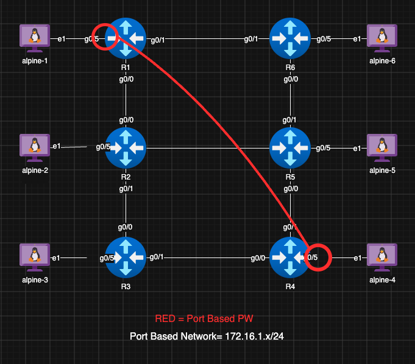

# Task 3 - Build a Port-Based Pseudowire between R1 and R4

!!! info ""
    **Prerequisite:** complete [Task 2 - Build the Underlay on R1](TASK2.md) first. This task needs R1 to reach R4's
    loopback (`4.4.4.4`) across the SR-MPLS core.

**Goal:** connect **alpine-1** and **alpine-4** as if they were plugged into the same Ethernet switch, even though
they sit on opposite sides of the MPLS core. You will build a **port-based pseudowire (PW)** between **R1** and **R4**,
signaled with **targeted LDP**, then ping across it.

**What you will learn**

- What a pseudowire is: an attachment circuit (AC) on each end plus an MPLS tunnel between the PEs
- Why LDP is used to signal the PW, and why the core needs no BGP
- Enabling targeted LDP (T-LDP) between two PE loopbacks without turning on LDP on any link
- Configuring a port-based attachment circuit and an `l2vpn` point-to-point cross-connect (`xconnect`)
- Verifying the PW, its labels and the LDP session, and testing it from the hosts and with PW OAM

**Time:** about 30 minutes.

---

## How it fits together

```
 alpine-1 ---- Gi0/0/0/5 [R1] ======= SR-MPLS core (OSPF + SR) ======= [R4] Gi0/0/0/5 ---- alpine-4
 172.16.1.1      AC                                                        AC               172.16.1.4
                  \_________ pseudowire, pw-id 100, signaled by targeted LDP ________/
```

- The **attachment circuit (AC)** is the router port facing the host. Here it is a whole port (`Gi0/0/0/5`), which is why this is called
  a **port-based** PW: every Ethernet frame that arrives on the port goes into the PW, tagged or untagged.
- The **pseudowire** carries those frames across the core inside MPLS. Each end advertises a **PW label** to the other end.
- **Targeted LDP** is how the two PEs exchange those PW labels. It is an LDP session between the PEs' **loopbacks**, not
  between neighbors on a link, so it needs no LDP on the core interfaces.
- The **transport** underneath is the SR-MPLS network you built in Task 2. SR delivers the packet to the far PE; the PW label tells
  that PE which AC to hand it to.
- The two hosts are in one Layer 2 segment, `172.16.1.0/24`. The routers never look at their IP addresses.

---

## Your Network



| | R1 | R4 |
|---|---|---|
| Loopback0 (PW peer address) | `1.1.1.1` | `4.4.4.4` |
| AC interface | GigabitEthernet0/0/0/5 | GigabitEthernet0/0/0/5 |
| Host on the AC | alpine-1, eth1 `172.16.1.1/24` | alpine-4, eth1 `172.16.1.4/24` |
| Host management address | `198.18.1.21` | `198.18.1.24` |
| PW peer | `4.4.4.4` | `1.1.1.1` |
| PW ID | `100` | `100` |

**Names used in this task**

- xconnect group `PORT_BASED`
- point-to-point name `R1_to_R4` on R1 and `R4_to_R1` on R4. The names only have local meaning. The **PW ID and the peer address must match** on both ends.

**Starting state**

- R1 has the Task 2 underlay. R2-R6 are pre-built.
- Gi0/0/0/5 is shut down on R1 and R4.
- **R2-R6 already have targeted LDP configured** (`mpls ldp` with a router-id). R1 does not, so you will add it.
- The alpine hosts are already addressed. Nothing to configure on them.

---

## Step 0 - Check where you are starting from

On **R1** (`198.18.1.11`, `cisco` / `cisco`), make sure the underlay works. The PW is only as good as the path under it.

```
ping 4.4.4.4 source 1.1.1.1
```

You must see `!!!!!`. If not, go back to Task 2.

Look at the AC port. It is shut down, and no PW exists yet:

```
show ip interface brief GigabitEthernet0/0/0/5
show running-config interface GigabitEthernet0/0/0/5
```

```
RP/0/RP0/CPU0:R1#show ip interface brief GigabitEthernet0/0/0/5
Interface                      IP-Address      Status                Protocol
GigabitEthernet0/0/0/5         unassigned      Shutdown              Down

RP/0/RP0/CPU0:R1#show running-config interface GigabitEthernet0/0/0/5
interface GigabitEthernet0/0/0/5
 shutdown
!
```

There is no LDP on R1 yet:

```
show running-config mpls ldp
show mpls ldp discovery
```

```
RP/0/RP0/CPU0:R1#show running-config mpls ldp
% No such configuration item(s)
```

Now log in to **alpine-1** (`ssh cisco@198.18.1.21`, password `cisco`) in a second window and try to reach alpine-4. It cannot work yet:

```
ping -c 3 172.16.1.4
```

```
PING 172.16.1.4 (172.16.1.4): 56 data bytes

--- 172.16.1.4 ping statistics ---
3 packets transmitted, 0 packets received, 100% packet loss
```

That is your "before". Keep this window open for the end of the task.

---

## Step 1 - Enable targeted LDP on R1

First look at how the other routers are set up. On **R4** (`198.18.1.14`):

```
show running-config mpls ldp
```

```
mpls ldp
 router-id 4.4.4.4
 address-family ipv4
  discovery targeted-hello accept
 !
!
```

There are two lines, and neither one names an interface:

| Line | What it does |
|---|---|
| `router-id 4.4.4.4` | The LDP identity and the address the TCP session uses. We set it to the **loopback** so the session runs loopback to loopback, over the underlay you built. |
| `discovery targeted-hello accept` | Lets this router accept targeted hellos from a PE it does not yet have a PW configured toward. |

!!! note ""
    **Why no interfaces?** Adding an interface under `mpls ldp` starts LDP *on that link*, and the router would also
    start handing out LDP labels for the core routes. We do not want that. The core already has SR labels. LDP
    here is only used to **signal PW labels** between two PEs.

Now configure the same thing on **R1**, using R1's loopback:

```
configure terminal
mpls ldp
 router-id 1.1.1.1
 address-family ipv4
  discovery targeted-hello accept
  exit
 exit
show configuration
```

Nothing is applied yet. `show configuration` lists only what you have staged, and you will see this output **before** you commit:

```
RP/0/RP0/CPU0:R1(config)#show configuration
!! IOS XR Configuration 25.1.1
mpls ldp
 router-id 1.1.1.1
 address-family ipv4
  discovery targeted-hello accept
 !
!
end
```

!!! warning ""
    **Note:** `discovery targeted-hello accept` must be inside `address-family ipv4`. If you type it directly under `mpls ldp`, XR answers `Invalid input`.

Only when the output matches what you intended, apply it:

```
commit
end
```

### Verify Step 1

```
show running-config mpls ldp
show mpls ldp discovery
show mpls ldp neighbor brief
```

```
RP/0/RP0/CPU0:R1#show mpls ldp discovery
Local LDP Identifier: 1.1.1.1:0
Discovery Sources:
RP/0/RP0/CPU0:R1#show mpls ldp neighbor brief
RP/0/RP0/CPU0:R1#
```

LDP is running, but there are **no discovery sources and no neighbors**. This is correct. A targeted session only starts when a PW asks for one, which is the next step.

---

## Step 2 - Build the R1 side: the AC and the PW

Two pieces are needed, an attachment circuit and a cross-connect.

**The attachment circuit.** Put `Gi0/0/0/5` into Layer 2 mode with `l2transport`, and bring it up. In this mode the port has no IP address; it just hands frames to the PW.

**The cross-connect.** An `xconnect` joins an AC to a PW. In IOS XR the structure is:

```
l2vpn
 xconnect group <group name>
  p2p <connection name>
   interface <AC>
   neighbor ipv4 <peer loopback> pw-id <id>
```

Configure R1:

```
configure terminal
interface GigabitEthernet0/0/0/5
 description to alpine-1 eth1
 l2transport
 exit
 no shutdown
 exit
l2vpn
 xconnect group PORT_BASED
  p2p R1_to_R4
   interface GigabitEthernet0/0/0/5
   neighbor ipv4 4.4.4.4 pw-id 100
   exit
  exit
 exit
show configuration
```

Nothing is applied yet. `show configuration` lists only what you have staged, and you will see this output **before** you commit:

```
RP/0/RP0/CPU0:R1(config-l2vpn)#show configuration
!! IOS XR Configuration 25.1.1
interface GigabitEthernet0/0/0/5
 description to alpine-1 eth1
 no shutdown
 l2transport
 !
!
l2vpn
 xconnect group PORT_BASED
  p2p R1_to_R4
   interface GigabitEthernet0/0/0/5
   neighbor ipv4 4.4.4.4 pw-id 100
   !
  !
 !
!
end
```

Notice the `shutdown` line is gone. `no shutdown` removes it from the configuration instead of adding a new line. Check the output above, then apply:

```
commit
end
```

### Verify Step 2 - a half-built PW

R4 has nothing yet, so this PW cannot come up. Look at what that looks like:

```
show l2vpn xconnect
```

```
RP/0/RP0/CPU0:R1#show l2vpn xconnect
Legend: ST = State, UP = Up, DN = Down, AD = Admin Down, UR = Unresolved,
        SB = Standby, SR = Standby Ready, (PP) = Partially Programmed,
        LU = Local Up, RU = Remote Up, CO = Connected, (SI) = Seamless Inactive

XConnect                   Segment 1                       Segment 2
Group      Name       ST   Description            ST       Description            ST
------------------------   -----------------------------   -----------------------------
PORT_BASED R1_to_R4   DN   Gi0/0/0/5              UP       4.4.4.4         100    DN
----------------------------------------------------------------------------------------
```

How to read this line:

- `ST DN` (first one): the whole cross-connect is down.
- Segment 1 (`Gi0/0/0/5`): the AC. It is shown up here because the port itself is up.
- Segment 2 (`4.4.4.4 100`): the PW. It is `DN` because the far end has not answered yet.

R1 has already started a targeted session toward R4:

```
show mpls ldp discovery
```

```
RP/0/RP0/CPU0:R1#show mpls ldp discovery
Local LDP Identifier: 1.1.1.1:0
Discovery Sources:
  Targeted Hellos:
    1.1.1.1 -> 4.4.4.4 (active), xmit/recv
      LDP Id: 4.4.4.4:0
          Hold time: 90 sec (local:90 sec, peer:90 sec)
          Established: Nov 19 19:34:50.571 (00:00:01 ago)
```

`(active)` means R1 started it. R4 is the passive side, and it accepts because of its `targeted-hello accept` line.
Your timestamp will differ.

Now try the ping from alpine-1 again. Still no luck:

```
ping -c 3 172.16.1.4
```

```
3 packets transmitted, 0 packets received, 100% packet loss
```

---

## Step 3 - Build the R4 side

Log in to **R4** (`198.18.1.14`). LDP is already there from the baseline, so only the AC and the `xconnect` are needed. Mirror what you did on R1: swap the names, the description and the peer address.

```
configure terminal
interface GigabitEthernet0/0/0/5
 description to alpine-4 eth1
 l2transport
 exit
 no shutdown
 exit
l2vpn
 xconnect group PORT_BASED
  p2p R4_to_R1
   interface GigabitEthernet0/0/0/5
   neighbor ipv4 1.1.1.1 pw-id 100
   exit
  exit
 exit
show configuration
```

Check that the output shows `neighbor ipv4 1.1.1.1 pw-id 100`, then:

```
commit
end
```

!!! warning ""
    **The two ends must agree.** The `pw-id` has to be the same on both PEs, and each PE's `neighbor` has to be the *other* PE's loopback. If either is wrong, the PW stays down. See Troubleshooting.

---

## Step 4 - Verify the pseudowire

Give it a few seconds, then on **R1**:

```
show l2vpn xconnect
```

```
RP/0/RP0/CPU0:R1#show l2vpn xconnect
...
XConnect                   Segment 1                       Segment 2
Group      Name       ST   Description            ST       Description            ST
------------------------   -----------------------------   -----------------------------
PORT_BASED R1_to_R4   UP   Gi0/0/0/5              UP       4.4.4.4         100    UP
----------------------------------------------------------------------------------------
```

Everything is `UP`: the cross-connect, the AC and the PW. Now the detail view, which shows what was negotiated:

```
show l2vpn xconnect detail
```

```
Group PORT_BASED, XC R1_to_R4, state is up; Interworking none
  AC: GigabitEthernet0/0/0/5, state is up
    Type Ethernet
    MTU 1500; XC ID 0x2; interworking none
  PW: neighbor 4.4.4.4, PW ID 100, state is up ( established )
    PW class not set, XC ID 0xa0000003
    Encapsulation MPLS, protocol LDP
    Source address 1.1.1.1
    PW type Ethernet, control word disabled, interworking none
    LSP : Up
    Nexthop type: IPV4 4.4.4.4
    PW Status TLV in use
      MPLS         Local                          Remote
      ------------ ------------------------------ -----------------------------
      Label        24014                          24014
      Group ID     0x1000020                      0x1000020
      Interface    GigabitEthernet0/0/0/5         GigabitEthernet0/0/0/5
      MTU          1500                           1500
      Control word disabled                       disabled
      PW type      Ethernet                       Ethernet
    Incoming Status (PW Status TLV):
      Status code: 0x0 (Up) in Notification message
    Outgoing Status (PW Status TLV):
      Status code: 0x0 (Up) in Notification message
```

(Output trimmed. Your label numbers may differ.) Things to read:

| Field | Meaning |
|---|---|
| `state is up ( established )` | The PW is signaled and working |
| `Encapsulation MPLS, protocol LDP` | The PW label was exchanged by LDP, as designed |
| `LSP : Up` | The transport path to `4.4.4.4` exists (this is your SR underlay) |
| `Label` Local / Remote | The PW label this router advertised, and the one the peer advertised. The two ends may use different numbers; they are independent |
| `MTU` | The interface MTU of each end. Both ends are expected to agree (here both are 1500) |
| `PW type Ethernet` | The PW carries Ethernet frames |
| `Status code: 0x0 (Up)` | Neither side reports a fault |

Next, the LDP session behind it:

```
show mpls ldp neighbor brief
```

```
RP/0/RP0/CPU0:R1#show mpls ldp neighbor brief
Peer               GR  NSR  Up Time     Discovery   Addresses     Labels
                                        ipv4  ipv6  ipv4  ipv6  ipv4   ipv6
-----------------  --  ---  ----------  ----------  ----------  ------------
4.4.4.4:0          N   N    00:00:57    1     0     3     0     13     0
```

One session, to `4.4.4.4`, with one discovery source: the targeted hello. For more, run `show mpls ldp neighbor 4.4.4.4 detail`: it shows the TCP connection `4.4.4.4:xxxxx - 1.1.1.1:646` and `Clients: AToM`. AToM (Any Transport over MPLS) is the PW client of LDP.

Finally, the PW is now in the label table:

```
show mpls forwarding
```

```
24014  Pop         PW(4.4.4.4:100)    Gi0/0/0/5    point2point     0
```

That entry reads: a packet arriving from the core with PW label `24014` has the label removed (`Pop`) and goes out `Gi0/0/0/5`. The long list of `SR Pfx`
entries above it is the underlay carrying the traffic.

Do the same checks on **R4**: `show l2vpn xconnect` should show `R4_to_R1` and `UP`.

---

## Step 5 - Ping across the pseudowire

### From the hosts

On **alpine-1**:

```
ping -c 4 172.16.1.4
```

```
PING 172.16.1.4 (172.16.1.4): 56 data bytes
64 bytes from 172.16.1.4: seq=0 ttl=42 time=10.942 ms
64 bytes from 172.16.1.4: seq=1 ttl=42 time=6.328 ms
64 bytes from 172.16.1.4: seq=2 ttl=42 time=6.932 ms
64 bytes from 172.16.1.4: seq=3 ttl=42 time=6.638 ms

--- 172.16.1.4 ping statistics ---
4 packets transmitted, 4 packets received, 0% packet loss
```

Your "before" ping failed. Now it works. Look at how alpine-1 found alpine-4:

```
ip neigh show dev eth1
```

```
172.16.1.4 lladdr 52:54:00:1d:64:99 ref 1 used 0/0/0 probes 4 REACHABLE
```

alpine-1 got alpine-4's **MAC address** by ARP (the MAC addresses in your lab will differ). ARP is a Layer 2 broadcast protocol, so this proves the two hosts really share one Ethernet segment across the core. Nothing in
the path is routing between them. Try it the other way, from **alpine-4** (`ssh cisco@198.18.1.24`):

```
ping -c 3 172.16.1.1
```

### On the router: PW counters and PW OAM

Back on **R1**, the AC and PW counters have moved:

```
show l2vpn xconnect detail
```

Look at `Statistics: packets: received N, sent N` under both the AC and the PW. They count your pings.

Hosts can only prove that frames get through. The router can also test the PW itself, with **PW OAM** (an MPLS ping that follows the same path as the PW):

```
ping mpls pseudowire 4.4.4.4 100
```

```
RP/0/RP0/CPU0:R1#ping mpls pseudowire 4.4.4.4 100
Sending 5, 100-byte MPLS Echos to 4.4.4.4 VC: 100,
      timeout is 2 seconds, send interval is 0 msec:
...
Type escape sequence to abort.
!!!!!
Success rate is 100 percent (5/5), round-trip min/avg/max = 6/11/17 ms
```

The command takes the peer address and the PW ID. `!!!!!` means the far PE confirmed that it has a PW with this ID. This is the first thing to run when a PW looks wrong, because it tests the PW without needing any hosts.

---

## Final Verification

| # | Check | Where | Command | Expected |
|---|---|---|---|---|
| 1 | Underlay | R1 | `ping 4.4.4.4 source 1.1.1.1` | `!!!!!` |
| 2 | LDP configured | R1 | `show running-config mpls ldp` | router-id `1.1.1.1`, `discovery targeted-hello accept` under `address-family ipv4`, no interfaces |
| 3 | AC up | R1, R4 | `show ip interface brief GigabitEthernet0/0/0/5` | `Up / Up` |
| 4 | T-LDP session | R1, R4 | `show mpls ldp neighbor brief` | One peer (`4.4.4.4:0` on R1, `1.1.1.1:0` on R4), discovery `1` |
| 5 | PW up | R1, R4 | `show l2vpn xconnect` | `UP` / `UP` / `UP` |
| 6 | PW detail | R1 | `show l2vpn xconnect detail` | `state is up ( established )`, `protocol LDP`, `LSP : Up`, remote label shown (not `unknown`) |
| 7 | PW in label table | R1 | `show mpls forwarding` | `PW(4.4.4.4:100)` out `Gi0/0/0/5` |
| 8 | PW OAM | R1 | `ping mpls pseudowire 4.4.4.4 100` | `!!!!!` |
| 9 | Hosts | alpine-1 | `ping -c 4 172.16.1.4` | 0% packet loss |
| 10 | Hosts, other way | alpine-4 | `ping -c 3 172.16.1.1` | 0% packet loss |
| 11 | Layer 2 proof | alpine-1 | `ip neigh show dev eth1` | alpine-4's MAC address, `REACHABLE` |

---

## Troubleshooting

| Symptom | Likely cause | What to check |
|---|---|---|
| `Invalid input detected` on `discovery targeted-hello accept` | Typed under `mpls ldp` instead of `address-family ipv4` | Enter `address-family ipv4` first |
| `show l2vpn xconnect` shows `DN` / `UP` / `DN`, and `show mpls ldp discovery` shows a targeted hello | The other PE is not configured yet | Finish R4 (Step 3) |
| Detail shows `state is down ( local ready )` and the remote label is `unknown` | **PW ID mismatch** (for example 100 on R1, 101 on R4), or the other end points at the wrong peer | Compare `neighbor ipv4 ... pw-id ...` on both routers: `show running-config l2vpn` |
| AC shows `DN`, or detail says `state is down (Admin)` | Port still shut down | `no shutdown` on Gi0/0/0/5 and `commit` |
| Cross-connect is `UP` but hosts cannot ping | The host side, not the PW | On the host: `ip addr show eth1`. Both must be in `172.16.1.0/24` and the interface must be up. Then `ip neigh show dev eth1`: no `REACHABLE` entry for the other host means ARP is not getting through |
| No LDP session and no discovery entry | Core unreachable, so the loopbacks cannot talk | `ping 4.4.4.4 source 1.1.1.1` from R1: if it fails, go back to Task 2 |
| `ping mpls pseudowire` fails but the xconnect is `UP` | Check the PW ID and peer in the command | Use the exact `neighbor ... pw-id` from the config |

!!! tip ""
    **Tip - a mistake you can undo.** If you commit a wrong PW ID, use what you learned in Task 1:
    `show configuration commit list`, then `rollback configuration last 1`. Or fix the line and `commit` again.

---

## Compare with the answer

Try it yourself first. If you get stuck, or want to check your work, the finished configuration for this task is in
[ANSWERS.md](ANSWERS.md#task-3-port-based-pseudowire-r1-and-r4).

---

## Questions to think about

1. Why does the PW use the **loopback** addresses for the LDP session and not the link addresses?
2. What would change if you also enabled LDP on the core interfaces? Why do we avoid it here?
3. R4's Gi0/0/0/5 is connected to R1's by the PW. What would alpine-1 see if you connected a **third** host to R4's port? (Hint: a port-based PW carries everything that arrives on the port.)
4. The PW ID is `100` on both ends. Does it have to be unique across the whole network, or only between the two PEs?

<details markdown="1">
<summary>Answers</summary>

1. A loopback never goes down while the router has any working link, so the session survives a core link failure (TI-LFA from Task 2 keeps the path alive). A link address would drop with that link.
2. The routers would start advertising LDP labels for the core routes alongside the SR labels, and there would be two label systems to run and troubleshoot. The SR core already provides transport, and LDP's only job here is signaling the PW.
3. It would join the same Layer 2 segment. A port-based PW is a wire between two ports; it does not filter on VLAN or MAC. Several hosts behind a switch would all be bridged to the far side. (Not tested in this lab.)
4. The PW ID identifies the PW between a given pair of PEs, so it must match on those two. It is not a network-wide number. The same ID can be reused toward a different peer, although most designs keep them unique to make troubleshooting easier.

</details>

---

**Next:** [Task 4 - Build VLAN-Based Pseudowires](TASK4.md).
