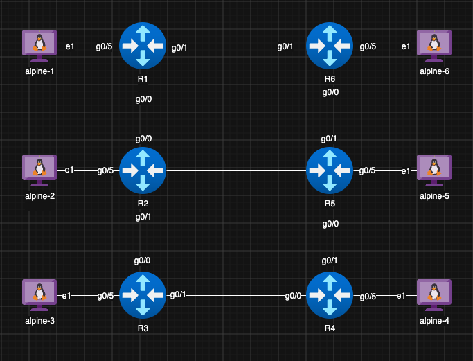

# Austin XR PW Services Workshop

In this lab you build **pseudowires (PWs)** on **Cisco IOS XR**. A pseudowire carries Layer 2 traffic across an
MPLS core, so two hosts on the same subnet can reach each other even though routers sit between them.

You do not need any IOS XR experience. Task 1 teaches the XR way of working first, and every later task
builds on the one before it.

## The lab

Six routers (R1 to R6) form an SR-MPLS core running OSPF. Each router has a Linux host (alpine-1 to alpine-6)
attached to its Gi0/0/0/5 port. R2 to R6 are already configured. **You build R1**, and then you configure the pseudowires.

## Tasks

| | Task | You will | Time |
|---|---|---|---|
| 0 | [Lab Access](LAB-ACCESS.md) | Connect to the lab network (VPN) and open SecureCRT sessions to every device | - |
| 1 | [XR Basics](TASK1.md) | Learn `commit`, `abort` and rollback, and enable R1's core ports | 30 min |
| 2 | [Underlay](TASK2.md) | Bring up OSPF, SR-MPLS and TI-LFA on R1 | 30 min |
| 3 | [Port-Based PW](TASK3.md) | Connect alpine-1 and alpine-4 with a port-based pseudowire (R1 to R4) | 30 min |
| 4 | [VLAN-Based PWs](TASK4.md) | Chain VLAN-based pseudowires so alpine-2 reaches alpine-6 | 45 min |

Do the tasks in order. If you get stuck, the finished configuration for each task is on the [Answers](ANSWERS.md) page.

## How the guides work

- Type the commands exactly as shown. Every block has a **copy** button in its top-right corner.
- On XR, a change does nothing until you `commit`. The guides tell you to run `show configuration` and check it **before** you commit.
- Command output shown below a block is what you should see. If yours is different, check the troubleshooting notes at the end of the task.
- The login for every router and host is `cisco` / `cisco`.
